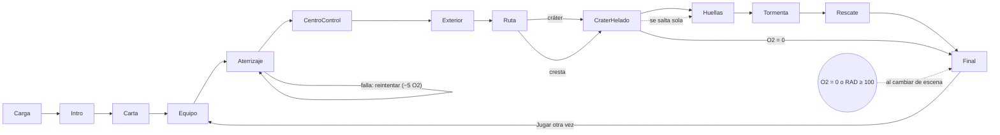

# Revisión técnica final — Rescate en el Polo Sur Lunar

## Estado final (Fases 2 y 3)

### Corregido
| # | Qué | Dónde |
|---|---|---|
| 1 | **Al jugar otra vez, el juego se trababa**: Phaser reutiliza cada escena y algunas banderas no se reiniciaban. Exterior no dejaba seguir después de la carrera del rover y no volvía a mostrar a STELLA; Huellas y el cráter no dejaban seguir; Equipo no bajaba la rampa si se elegía la misma nave. Ruta y Tormenta empezaban con lo marcado en la partida anterior. *(Lo encontró el equipo al jugar.)* | `create()` de Exterior, Huellas, CraterHelado, Equipo, Ruta, Tormenta, Rescate, Final y CentroControl |
| 2 | El oxígeno siempre cambia con `estado.cambiar()` (el reintento del Aterrizaje ya no lo baja de 0) — B3 | Aterrizaje, Equipo, CentroControl |
| 3 | La tarjeta "Saber más" de STELLA se cierra al cambiar de categoría o de sección — B5 | CentroControl |
| 4 | Candado contra el doble toque en las decisiones del Rescate — B7 | Rescate |
| 5 | Etiqueta **"en vivo" / "no en vivo"** en el dato de DONKI y una sola etiqueta de fuente en todo el juego (`etiquetaDato`) — B2 | ui.js ⚙️, Carga.js ⚙️, Rescate, Final, CentroControl, textos.json |
| 6 | Las barras se llenan con el máximo real (O2 hasta 150): ya se ven el tanque y la nave grande — B4 | ui.js ⚙️ |
| 7 | **Funciona sin internet**: copia local de Phaser 3.80.1 (verificada idéntica al CDN), con el CDN de respaldo — B1 | index.html, lib/ |
| 8 | Rama muerta `"Crater"` quitada — B9 | Ruta |
| 9 | Tope de 50 ms al tiempo entre cuadros — P1 | Equipo, CentroControl, Huellas |
| 10 | Escalas enteras: 0.625→0.75, 2.2→2, 0.55→0.5, 0.6→0.5 — P3 | CentroControl, Tormenta, Final |
| 11 | Arcade Physics quitado (nadie lo usaba) — P4 | main.js ⚙️ |
| 12 | **Teclado** en todas las escenas: flechas + Enter (+ Esc para cerrar tarjetas) en Carta, Aterrizaje, Tormenta, Rescate y Final; flechas + Enter en la Ruta; Enter al salir del cráter | ui.js ⚙️ (`navegarConTeclado`), Ruta, CraterHelado |
| 13 | Un solo `llenar()`, y los sonidos en un solo archivo | ui.js, src/sonidos.js |
| 14 | Textos escritos en el código → textos.json. Faltas corregidas (día, dañó, ¡…!). El botón de la Carta decía "Ir al Centro de Control" y lleva al hangar: ahora dice "Ir al hangar" | varias escenas, textos.json |
| 15 | Números del Aterrizaje en config.js (sin cambiar valores); `siguienteEscena` en Intro y Carta; `LIMITES`/`ORDEN` locales renombrados | config.js ⚙️, Aterrizaje, Intro, Carta, CentroControl, Equipo |
| 16 | Cada archivo dice en su cabecera qué lee, qué escribe y a qué escena sigue | todos |
| 17 | `pruebas/balance.html` rehecha con el flujo actual y las funciones reales del modelo — B10 | pruebas/ |
| 18 | LEEME actualizado (cómo correrlo, carpetas, reglas, fuentes con enlaces) | LEEME.md |

⚙️ = archivo del núcleo (cambio mínimo).

### Segunda ronda (cambios pendientes)
| # | Qué | Dónde |
|---|---|---|
| 19 | **Balance**: la cresta pasa de 16 a 12 km; sin comida, esperar en un refugio de la Tormenta cuesta −10 O2 (y la tarjeta lo dice); la nave grande tarda 8 h en vez de 12; reintentar el Aterrizaje cuesta −2 O2. Resultado con la CME guardada: **79 de 104 equipos pueden ganar** (antes 33); cada opción gana entre 29 % y 65 % de las partidas; todos los objetos cambian algún resultado. Con linterna conviene el cráter; sin linterna, la cresta | datos.json, config.js ⚙️, simulacion.js, Tormenta |
| 20 | Se probó bajar el regreso en rover a −6 O2, pero así el rover dominaba (menos oxígeno **y** menos radiación). Se dejó en −12: caminar ahorra oxígeno, el rover protege de la radiación, y la tarjeta ya lo explica | datos.json |
| 21 | Barra ESC quitada (el escudo nunca cambiaba); el escudo sigue protegiendo por dentro | ui.js ⚙️ |
| 22 | Táctil: aviso "Gira tu teléfono" en teléfonos en vertical; zona para tocar los botones 2 px más grande por lado (sin cambiar el dibujo); Huellas explica que la lupa se arrastra con el dedo | index.html, ui.js ⚙️, textos.json |
| 23 | Código muerto quitado: la opción "refugio" (modelo, textos y datos), `costosRescate`, `ui.paginas()` | simulacion.js, Ruta, ui.js, datos, textos |
| 24 | Datos verificados con fuente NASA: velocidad del rover (VIPER, 0.36–0.72 km/h; el juego usa 0.5), luz del polo sur (NASA Science), polvo lunar (Gaier 2005, NTRS). El polvo ahora aparece en "Fuentes NASA" | datos.json, Final, LEEME |
| 25 | Pantalla de inicio de película: «STELLA'S RIDE» en letras pixel amarillas (fuente 5×7 hecha con mapas de letras), estrellas, la Luna y un rover que la recorre; «CoderWolf presenta», subtítulo y «Toca o presiona Enter». El primer toque salta la animación. El nombre se cambia en `textos.json → pantalla_titulo` | src/escenas/Titulo.js (nueva), main.js ⚙️, config.js ⚙️ (`ORDEN`), Carga.js ⚙️, index.html |
| 26 | **El Sol de hoy sin esperar a la NASA**: el juego arranca al instante con un respaldo real (última consulta buena guardada o la tormenta de mayo de 2024, 1332 km/s según DONKI) y consulta DONKI en segundo plano; el dato en vivo se usa si llega antes de la Ruta (si no, en la siguiente partida). Distingue nube rápida / Sol tranquilo / sin conexión, y la pantalla de título lo anuncia. El modelo limita el efecto entre 1000 y 1700 km/s (antes, 2500 km/s dejaba ganar al 18 %). La CME de respaldo ya no es un dato de ejemplo | src/nasa/sol.js (nuevo), donki.js, Carga.js ⚙️, simulacion.js, Titulo, Ruta, Tormenta, Equipo, ui.js ⚙️, datos.json, textos.json, pruebas/tormentas.html (nuevo) |
| 27 | Clave propia de api.nasa.gov (1000 consultas por hora) y **5 tormentas reales verificadas en DONKI** que iban hacia la Tierra: San Patricio 2015 (1000 km/s), Halloween 2021 (1109), mayo 2024 (1332), octubre 2024 (1509) y septiembre 2017 (1636). Sin dato en vivo se elige una al azar: cada partida puede tocar una distinta, de fácil a muy difícil | donki.js, datos.json |
| 28 | El Final cierra la historia del Sol: «☀ Tu tormenta es real: …» (en vivo, famosa o guardada), con enlace a DONKI | Final.js, textos.json |
| 29 | **Escena Rocas** (entre Huellas y Tormenta): rodear con el rover (más oxígeno, el rover sigue) o cruzar a pie (el oxígeno sube con los kg de mochila + traje y con el traje blindado; el rover se queda, así que no hay refugio bajo el rover en la Tormenta y el regreso es caminando). Se ve el peso que se carga («en la Luna todo pesa la sexta parte») y se pueden soltar objetos antes de cruzar. Dato real: gravedad lunar 1.62 m/s² (NASA Moon Fact Sheet). Escribe `estado.misiones.rocas`; también entra en la bitácora del Final y en `pruebas/balance.html` (CME 1332 km/s: 90 de 104 equipos ganables; rodear 49 %, a pie 38 %) | src/escenas/Rocas.js (nueva), simulacion.js, datos.json, textos.json, main.js ⚙️, config.js ⚙️ (`ORDEN`), Final.js |
| 30 | Títulos sin número: «Aterrizaje» y «La mochila» (antes «Misión 1/2 · …») | textos.json |
| 31 | Escena **Senal** quitada: su minijuego ya vive en el Centro de Control (STELLA). `estado.mision1` queda por compatibilidad | Senal.js (borrada), main.js ⚙️, comentarios |
| 32 | Rocas a **pantalla completa**: la ilustración ocupa todo el ancho; la carga y el detalle van en paneles sobre el cielo y las opciones abajo (ya no repite el formato de la Tormenta) | Rocas.js |
| 33 | Escena **Viaje** rehecha: «¡Alerta solar!» en pleno vuelo con la nube real (DONKI o famosa), entre Equipo y Aterrizaje. Tres opciones: cargar el escudo (+30 escudo, −6 O2), acelerar (aterrizas 3 h antes, con 70 % del combustible) o guardar el aire. La mejor depende del Sol del día: con 1700 km/s conviene el escudo. Desde aquí la tormenta de la partida queda fija. Balance (CME 1332): 94 de 104 equipos ganables; las tres opciones entre 38 % y 47 % | Viaje.js, simulacion.js, Aterrizaje (combustible), datos.json, textos.json, config.js ⚙️ (`ORDEN`), Final, balance.html |
| 34 | Juego completo en **inglés** (textos, datos NASA, fechas «May 10, 2024», letreros, barra de pruebas); la estructura no cambió | textos.json, datos.json, diario.json, ui.js, sol.js, index.html |
| 35 | Pantalla «Real science!» (fuentes): cada tarjeta vuelve a mostrar **su fuente NASA**, se puede tocar para abrir la página, y la tormenta dice «not live» cuando no vino en vivo | Final.js |
| 36 | Diario: página nueva para la **alerta solar del Viaje** y **teclado** (Esc vuelve al Final; Enter/Espacio pasan la página) | Diario.js, textos.json |
| 37 | Limpieza: `Final.panel()` sin uso, 30 textos sin uso, `Equipo.rotulo()`, import `ALTO` en Tormenta, campos de Rocas que no existen en el Diario, y campos reservados del estado (`hielo_kg`, `chispaEncontrado`, `estacionDSN`, `mensajeEnviado`, `combustibleRestante`, `carga`, `mision1`) | Final, Diario, Equipo, Tormenta, CentroControl, Carga, estado.js ⚙️, textos.json |

### Pendiente
- Datos que siguen de ejemplo (son valores de juego): rutas y radiación (puntos de juego). Agregar más tormentas famosas verificadas a `cme_historicas` con `pruebas/tormentas.html`.
- Posición dibujada redondeada al pixel (P2): obliga a separar la posición lógica de la dibujada en Equipo, CentroControl y Exterior; mucho riesgo para un temblor de 1 pixel.
- TODO de arte (Rol 3): fuente pixel y PNG.

### Lista de verificación final
| Prueba | Resultado |
|---|---|
| Sintaxis de los 30 módulos (no hay Node: los carga el navegador sin ventana) y JSON válidos | ✅ |
| Las 14 escenas abren en modo prueba sin errores de consola | ✅ |
| Fugas al cerrar escena: listeners iguales después de 3 reinicios, en las 14 | ✅ |
| Todas las claves `textos.*` y `datos.*` del código existen | ✅ |
| Partida completa **ganada** desde la Carta (blindado, nave pequeña, linterna + botiquín + comida, cráter) → "¡Misión completa!", O2 4, RAD 33 | ✅ |
| Partida **perdida por radiación** (ligero, nave grande, comida, cráter sin linterna) → Evacuación; Chispa nombra «Por el cráter» (+172) | ✅ |
| Partida **perdida por oxígeno** (blindado, nave pequeña, comida, cráter sin linterna) → Evacuación al reparar la radio; Chispa nombra el cráter (−56 O2) | ✅ |
| Jugar dos veces seguidas (misma nave, Exterior, Huellas, Ruta, Tormenta) sin trabarse | ✅ |
| Rescate → Final → Fuentes → Bitácora → Jugar otra vez **solo con teclado** | ✅ |
| Carta, Ruta, Tormenta y Aterrizaje (menú, fallo y reintento) solo con teclado | ✅ |
| Pantalla de fuentes con 15 filas (el resumen dice 11 datos reales y 3 de ejemplo) y etiqueta "no en vivo" sin red | ✅ |
| Balance sin opciones dominantes (`pruebas/balance.html`, CME 1500 km/s) | ✅ 79/104 equipos ganables; opciones entre 29 % y 65 % |

---

Fase 1 (auditoría). Revisé el código en `main` (incluye los 2 commits sin subir: misión final y descarga de la insignia). No se modificó ningún archivo del juego.

**Cómo se revisó**
- Leí todo `src/`, `datos/`, `index.html`, `LEEME.md` y `pruebas/`.
- Abrí las **14 escenas en modo prueba** (`?escena=X&sinred=1`) con Edge sin ventana. Cada escena se reinició 3 veces para comparar los listeners antes y después.
- Un script revisó que cada `this.t.*`, `estado.textos.*` y `estado.datos.*` usado en el código exista en los JSON.
- Recalculé el balance en Python con las mismas fórmulas de `simulacion.js`. Probé **104 equipos iniciales** (2 trajes × 2 naves × 13 mochilas válidas × 2 rutas) y, para cada uno, las **36 combinaciones** de decisiones que vienen después.

**Resultado rápido**
- Ninguna escena falla al abrir.
- No hay errores de consola.
- No hay fugas de listeners.
- Todas las claves de texto y de datos existen.
- Los problemas grandes son de **balance** y de **requisitos** (offline, "no en vivo", teclado y táctil), no de errores de código.

---

## a) Mapa del juego

| # | Escena | Lee del estado | Escribe en el estado | Siguiente |
|---|---|---|---|---|
| 0 | Carga | `datos.json`, `textos.json`, DONKI (8 s máx.) | `datos`, `textos`, `datos.cme`, `donkiEnVivo`; en modo prueba, `ESTADO_PRUEBA` | Intro (o la escena de `?escena=`) |
| 1 | Intro | `textos.intro` | — | Carta (escrito a mano) |
| 2 | Carta | `textos.carta` | `nuevaPartida()`, `nombreClave` | Equipo (escrito a mano) |
| 3 | Equipo | `TRAJES`, `NAVES`, `oxigeno` (solo muestra) | `traje`, `nave`, `oxigeno += oxigenoExtra`, `bitacora` | Aterrizaje |
| 4 | Aterrizaje | `nave`, `traje` | `oxigeno −5` por reintento, `bitacora` | CentroControl |
| 5 | CentroControl | `traje`, `nave`, `mision1`, `datos.cme` | `mochila`, `oxigeno +20` (tanque), `mision2`, `bitacora` | Exterior |
| 6 | Exterior | `textos.exterior` | `misiones.exterior`, `bitacora` (la batería es local, no usa `estado.energia`) | Ruta |
| 7 | Ruta | `rutas`, `modelo`, `radiacion`, `cme`, `traje`, `nave`, `mochila`, `escudo` | `oxigeno`, `radiacion`, `misiones.ruta`, `bitacora` | CraterHelado |
| 8 | CraterHelado | `misiones.ruta.id`, `traje`, `mochila` (linterna) | `oxigeno`, `misiones.crater`, `bitacora` | Huellas (con O2 en 0: Final; con la cresta se salta sola) |
| 9 | Huellas | `datos.huellas` | `oxigeno`, `bitacora` | Tormenta |
| 10 | Tormenta | `datos.tormenta`, `cme`, `misiones.ruta`, `misiones.rocas`, `traje`, `escudo`, `mochila` | `oxigeno`, `radiacion`, `misiones.tormenta`, `bitacora` | Rescate |
| 11 | Rescate | `misiones.tormenta`, `misiones.rocas`, `mochila` (radio, botiquín), `oxigeno` | `oxigeno`, `radiacion`, `misiones.rescate`, `bitacora` | Final |
| 12 | Final | todo (`misiones.*`, `bitacora`, `oxigeno`, `radiacion`, `datos`) | `insignia`; "Jugar otra vez" llama a `nuevaPartida()` | Equipo |
| — | Senal *(fuera del recorrido)* | `textos.senal` | `mision1` | CentroControl |
| — | Viaje *(fuera del recorrido)* | `cme` | `escudo`, `oxigeno`, `bitacora` | Aterrizaje (escrito a mano) |

**Regla de derrota** (`main.js:27-34`): si `oxigeno ≤ 0` o `radiacion ≥ 100`, cualquier `scene.start` hacia una escena posterior a la Carta va al **Final**. `scene.restart` (los reintentos del Aterrizaje) y la barra de pruebas no pasan por esa regla.

Registros que se esperan y aún no existen: `estado.misiones.rocas` (escena Rocas de Shadia). Sin ella, el rover está siempre disponible en la Tormenta y en el regreso.

---

## b) Bugs

Gravedad: **Alta** rompe un requisito o la partida · **Media** se nota al jugar · **Baja** casi no se nota o es de mantenimiento.

| # | Gravedad | Archivo:línea | Qué pasa | Cómo reproducirlo |
|---|---|---|---|---|
| B1 | Alta | `index.html:12` | Phaser se carga del CDN. **Sin internet el juego no arranca** (pantalla azul), así que el respaldo de DONKI nunca llega a usarse. | Desconectar la red y abrir `index.html` con Live Server. |
| B2 | Alta | `Carga.js:38`, `ui.js:26-37` | `estado.donkiEnVivo` se escribe pero **ninguna pantalla lo usa**: nunca se muestra "en vivo" ni "no en vivo". Sin red, la CME aparece solo como "DATO DE EJEMPLO". | Abrir sin `&sinred` con la red cortada y ver la etiqueta de la Tormenta. |
| B3 | Media | `Aterrizaje.js:442` | `estado.oxigeno -= 5` no usa `estado.cambiar()`: el oxígeno puede bajar de 0 (y la barra lo oculta). | `?escena=Aterrizaje&oxigeno=3&sinred=1`, aterrizar mal una vez: O2 queda en −2. |
| B4 | Media | `ui.js:60` | La barra se llena con `valor × 0.4` hasta 40 px: **a partir de 100 de oxígeno se ve llena**. Con 100, 120 o 130 se ve igual, así que el niño no ve el tanque (+20) ni la nave grande (+10). | `?escena=Ruta&oxigeno=100` y luego `&oxigeno=130`: las barras son idénticas. |
| B5 | Media | `CentroControl.js:805` | STELLA, Entorno: con la tarjeta "Saber más" abierta, tocar otra categoría la cambia **detrás** de la tarjeta, que sigue mostrando el texto anterior. `categoria()` no cierra la tarjeta, y el botón corta la propagación del clic que la cerraría. | Abrir STELLA → Entorno → Saber más → tocar "B". |
| B6 | Media | `estado.js:30`, juego completo | El escudo (40) **nunca cambia** en el recorrido (solo lo cambia Viaje, que está fuera). La barra ESC está siempre igual, y no queda claro qué significa frente al objeto "escudo" de la mochila. | Jugar completo: ESC no se mueve. |
| B7 | Baja | `Rescate.js:274` | `decidir()` no tiene candado. En la última decisión (regreso), el botón sigue activo hasta el siguiente cuadro: dos toques en el mismo cuadro cobran el regreso dos veces. Tormenta, Ruta y Equipo sí tienen candado. | Doble toque muy rápido en "Volver en el rover" (difícil, pero posible en pantallas táctiles). |
| B8 | Baja | `nasa/donki.js:3` | `DEMO_KEY` permite unas 30 consultas por hora por IP. En una feria con Wi-Fi compartido, casi todos verán el dato guardado. | Abrir el juego más de 30 veces en una hora desde la misma red. |
| B9 | Baja | `Ruta.js:278` | Busca la escena `"Crater"`, que no existe; siempre usa `siguienteEscena`. El comentario dice que sigue a "Rescate". | Leer el código: es código muerto. |
| B10 | Baja | `pruebas/balance.html` | Modela el flujo viejo (refugio, `costosRescate`, sin CraterHelado, Huellas, Tormenta ni el Rescate nuevo). El LEEME dice que confirma que "todo está en verde", pero ya no lo prueba. | Abrirla: muestra la columna "refugio", que el juego ya no ofrece. |
| B11 | Baja | `Intro.js:64`, `Carta.js:39`, `Viaje.js:30` | El destino está escrito a mano en lugar de `siguienteEscena`. Hoy coincide con ORDEN, pero se rompe si cambia el orden. | — |
| B12 | Baja | `Senal.js` (AudioContext) | Aviso de audio en consola solo al abrir Senal sola. En la prueba sin ventana no apareció. | `?escena=Senal` en Chrome. |

**Revisado y sin problemas**
- Imports rotos: ninguno.
- Claves de escena, texto y datos que no coincidan: ninguna, salvo la de B9.
- Fugas al cerrar escena: ninguna. Los listeners de escena, teclado, juego y escala quedan iguales después de 3 reinicios en las 14 escenas.
- Exterior apaga el motor de audio al salir, y CentroControl y Senal limpian en `shutdown`. El `setInterval` de `pruebas.js` no se limpia, pero solo existe con `?dev=1`.
- Modo prueba: las 14 escenas abren.
- DONKI: tiene un límite de 8 s, devuelve `null` si falla y usa la CME guardada si es lenta.
- Estado que no se reinicia: `mision1` e `insignia` sobreviven a `nuevaPartida()` a propósito, y está documentado.

---

## c) Precisión de movimiento y física

| # | Archivo:línea | Hallazgo | Efecto |
|---|---|---|---|
| P1 | `Equipo.js:789`, `CentroControl.js:1162`, `Huellas.js:362` | Usan `delta` pero **sin tope**. Aterrizaje, Exterior, Ruta, Tormenta y CraterHelado lo limitan a 50 ms. | Tras un tirón, en Equipo un paso con flechas puede pasar de 4 px y atravesar las columnas del arco (4 px de ancho, `Equipo.js:62`). Riesgo bajo. |
| P2 | `Equipo.js:845`, `CentroControl.js:1209`, `Exterior.js:695`, seguidores Bit/Chispa | Las posiciones son decimales y la cámara tiene ZOOM 4. Cada personaje se mueve en pasos de ¼ de pixel del dibujo y queda desalineado del fondo ("mixels"). `roundPixels` no está fijado en `main.js`. | Personajes que "tiemblan" un pixel al caminar. Solo es visual. |
| P3 | `CentroControl.js:935,1006` (0.625), `Tormenta.js:100` (2.2), `Tormenta.js:103` (0.55 en y), `Final.js:182` (0.6) | **Escalas que no son enteras** respecto al ZOOM: 0.625 × 4 = 2.5 px, 2.2 × 4 = 8.8 px y 0.55 × 4 = 2.2 px por pixel del dibujo. | Pixeles de distinto tamaño en el mismo sprite. Las escalas 0.5, 0.75 y 1.5 sí dan pixeles enteros (2, 3 y 6 px). |
| P4 | `main.js:56`, `main.js:43` | Arcade Physics se carga en todas las escenas y **ninguna lo usa**. Todas las colisiones son a mano (cuadrícula en Equipo, `choca()` en Exterior). | Peso y configuración de más; no da errores. |
| P5 | `ui.js:20` (botón de 18 px de alto) | En un teléfono **horizontal** de 800×360, FIT escala ×0.5: un botón mide unos 36 px CSS (lo recomendado es 44). En **vertical** mide unos 20 px y el texto `tam: 5` unos 6 px. No hay aviso de "gira tu teléfono". | Botones difíciles de tocar en teléfono. |
| P6 | `Huellas.js` (lupa) | En pantalla táctil, la lupa solo se mueve **arrastrando** el dedo (`pointermove`). No hay pista visual de eso. | Un niño puede tocar sin entender por qué no pasa nada. |

Sin problemas: Aterrizaje (física con `dt` y tope, gravedad lunar real de 1.62), los límites del Exterior (`SUELO` y `PIE` con `Clamp`), el rover en emergencia (reversa), la búsqueda de camino de Equipo y la lupa de Huellas (limitada al mapa).

---

## d) Coherencia de diseño

### d.1 Balance: hay opciones dominantes y equipos que no pueden ganar

Supuestos de la cuenta:
- CME de 1500 km/s (la guardada).
- Aterrizaje al primer intento.
- Cráter cruzado con calefacción y sin choques.
- Huellas con −3 O2.
- Cada equipo inicial se juega con sus 36 combinaciones de Tormenta (3) × aire (2) × mensajes (3) × regreso (2).

**Resultado: 69 de 104 equipos iniciales (66 %) no pueden ganar, decida lo que decida el niño después.**

**1. La cresta está dominada por el cráter en tiempo, radiación y oxígeno.**

Horas de ruta, con `(km / 0.5 + subida / 500) × 1.5` si es oscura y no hay linterna:

| | Cálculo | Horas |
|---|---|---|
| Cráter sin linterna | (10 / 0.5 + 400 / 500) × 1.5 | **31.2 h** |
| Cresta | 16 / 0.5 + 100 / 500 | **32.2 h** |
| Cráter con linterna | 10 / 0.5 + 400 / 500 | **20.8 h** |

La cresta tarda más **incluso contra el cráter a oscuras**.

Ejemplo con traje ligero, nave pequeña y sin escudo:
- La tormenta llega en `149 600 000 / 1500 / 3600 − 2` = **25.7 h**.
- Cresta: queda **6.5 h** bajo la tormenta, que dan `6.5 × 20 × (1 − 0.25)` = **+97 de radiación** al terminar la Ruta. Pierde siempre.
- Cráter con linterna: llega antes (20.8 < 25.7), con **0 de radiación** y unos −38 O2 (19 de la ruta + 19 del cruce).

La cresta pierde en 42 de sus 52 equipos. El texto la presenta como "larga y con luz" (la segura), pero los números la castigan.

**2. La comida no sirve para nada.** Solo la usaba la opción "refugio" de la Ruta (`simulacion.js:68`), que la Ruta ya filtra (`Ruta.js:66`). Pesa 2 kg y no tiene efecto: es una trampa, no una decisión.

**3. Traje ligero con nave grande nunca gana** (0 de 26 equipos). La nave grande deja solo 15.7 h antes de la tormenta, y el traje ligero protege poco.

**4. La linterna es casi obligatoria.** Sin linterna solo se gana llevando el escudo o con traje blindado y nave pequeña.

**5. Volver en rover cuesta más oxígeno que caminar** (`datos.json:174-177`):

| Regreso | Oxígeno | Radiación |
|---|---|---|
| Rover | −12 O2 | rad(1 h) |
| Caminar, traje ligero | −round(4 × 1.6 × 1.2) = **−8 O2** | rad(4 h) |

Es una decisión real, pero contraria a lo que un niño espera.

**6. Las decisiones de Tormenta y Rescate sí están bien equilibradas.**
- Tormenta (`opcionesTormenta`):

  | Opción | Oxígeno | Radiación | Horas que espera Itzel |
  |---|---|---|---|
  | Saliente | −7g | f·(1 − pP)·2.8 | +7 |
  | Rover | −3.6g | f·(1 − pP)·3.9 | +6 |
  | Seguir | −2.4g | 6f·(1 − pP) | 0 (pero la tormenta sigue) |

  g = gasto de O2 del traje · f = fuerza de la tormenta · pP = protección del traje y el escudo.
- Aire: la manguera cuesta `max(10, 0.3 × O2 + horas)`; la reserva cuesta `12 + 3g` más radiación. Con poco O2 conviene la manguera; con mucho, la reserva.
- Mensajes: "ayuda" baja a la mitad el O2 del regreso, a cambio de no tener el final completo.

**7. Castigo por reintentar el Aterrizaje:** −5 O2 cada vez, sin tope. Con equipos ajustados, un niño que falla 2 o 3 veces queda condenado sin saberlo (las barras no muestran números, ver B4).

> Nada de esto se cambia sin tu aprobación: es balance y diseño.

### d.2 Fórmulas y unidades

- `horasDeLlegada` usa la distancia Sol–Tierra (149.6 millones de km) para llegar a la Luna. Es una aproximación válida, porque la Luna está a 0.3 % de esa distancia.
- La radiación está en **puntos de juego** (100 = se pierde). `datos.radiacion.dato_real_uSv_hora` es 0 y no se usa; si se va a mostrar un dato de RadLab, falta el número.
- Gravedad: Aterrizaje usa 1.62 m/s² y Equipo usa 1/6 (0.165 = 1.62 / 9.81). Coinciden.
- Velocidad del rover: 0.5 km/h (`datos.rover`, fuente "COMPLETAR"). Por eso 10 km toman 20 h. En el Exterior se dice que el tope del rover del Apolo es de unos 18 km/h (`Exterior.js:27`). Los dos números no coinciden y el niño puede notarlo.
- Las horas, el O2 y la radiación se muestran como números redondeados: sí son coherentes entre la Ruta, la Tormenta, el Rescate y la bitácora (revisado en la partida completa).

### d.3 Textos y nombres

- Hay **cuatro estilos de etiqueta** de fuente: `Dato real ·` (ui.js), `● DATO REAL ·` / `● Dato real ·` (textos de STELLA), `✓ Dato real` / `⚠ Dato de ejemplo` (Final) y `DATO DE EJEMPLO` (Rescate, escrito a mano).
- O2 se escribe "O2" (28 veces) y "oxígeno" (43). Las barras dicen "O2 / ESC / RAD". Es coherente, pero "ESC" no se explica (ver B6).
- Términos difíciles para 7–12 años: "eyecciones de masa coronal" (2 veces) y "regolito" (5 veces, con explicación). Hay 6 frases de 22 a 26 palabras en los textos "especialista" de STELLA y en `rescate.planta_texto`.
- El resto del lenguaje es corto y en segunda persona ("tú"), sin "usted" ni "ustedes". Es coherente.

---

## e) Requisitos

| # | Requisito | Estado | Qué falta |
|---|---|---|---|
| 1 | Niños de 7–12 años, lenguaje simple | **Parcial** | Acortar las 6 frases largas y explicar o quitar "eyecciones de masa coronal". El texto `tam: 5` es ilegible en teléfono (P5). |
| 2 | Decisiones reales, sin opción gratis ni dominante | **No cumple** | La cresta está dominada, la comida no tiene efecto, el traje ligero con nave grande no puede ganar y el 66 % de los equipos no puede ganar (d.1). Tormenta, Rescate y mensajes sí cumplen. |
| 3 | Pocos recursos a la vez | **Cumple** | 3 barras (O2, ESC, RAD); la batería solo vive en el Exterior. Ojo: la barra ESC no cambia nunca (B6). |
| 4 | Datos NASA reales con fuente visible, "DATO DE EJEMPLO" y "no en vivo" sin red | **Parcial** | Nunca se muestra "en vivo" ni "no en vivo" (B2). Siguen como ejemplo: rover ("COMPLETAR"), radiación, rutas, luz del polo sur, polvo y la CME de respaldo. Hay que unificar el estilo de las etiquetas. |
| 5 | Rejugable sin castigo; explica por qué perdió | **Parcial** | El Final explica la causa, muestra la cadena de decisiones y el "¿Y si…?", y "Jugar otra vez" funciona. Pero el reintento del Aterrizaje cobra O2 sin tope (d.1-7), las barras no muestran cuánto queda (B4) y la explicación nombra la última decisión cara, no la causa de fondo (por ejemplo, la cresta o el equipo). |
| 6 | Navegador, sin descargas ni cuentas; ratón, teclado y táctil | **Parcial** | Sin internet no arranca (B1). **Teclado:** Carta, Ruta, Tormenta, Rescate y Final solo funcionan con ratón o toque. **Táctil:** botones chicos en teléfono (P5) y la lupa de Huellas solo se mueve arrastrando (P6). |
| 7 | Sin datos personales | **Cumple** | El nombre clave se elige de una lista. No hay formularios, `localStorage` ni cookies, y la consulta a DONKI no lleva datos del niño. |
| 8 | Pantalla final con todas las fuentes NASA | **Cumple** | `fuentesNASA()` junta 13 fuentes con su etiqueta y enlace. Detalle: `crater_helado.polvo` está en datos pero no se muestra en ninguna escena; `zona_aterrizaje` aparece en la lista, pero ninguna escena la muestra. |

---

## f) Limpieza

**Código duplicado**
- `tono()` y `sonar()` están copiados igual en `CentroControl.js:1111-1150` y `Senal.js:259-300`, y en una variante en `Exterior.js:798-840`.
- `llenar()` (reemplazar `{clave}`) está definido **13 veces**: CentroControl, CraterHelado, Equipo, Exterior, Final, Huellas, Rescate, Ruta, Senal, sistemasRover, Tormenta, simulacion y pruebas.
- Caminar con seguidor (Bit o Chispa) y `revisarProximidad` están casi iguales en `Equipo.js` y `CentroControl.js`.

**Código muerto**
- `Viaje.js` (fuera del recorrido, con textos escritos a mano).
- `ui.paginas()` (sin uso).
- `costosRescate()` (solo lo usa el `balance.html` viejo).
- La opción "refugio" en `opcionesDeRuta` y `explicar`, junto con `textos.ruta.refugio` y `textos.ruta.sin_comida`.
- La rama `"Crater"` en `Ruta.js:278`.
- Arcade Physics (P4).
- Campos de `estado` que nadie lee: `hielo_kg`, `chispaEncontrado`, `estacionDSN`, `mensajeEnviado`, `combustibleRestante`, `carga`, `energia`, `mision2` (este último solo se escribe).
- Datos sin uso: `datos.radiacion.dato_real_uSv_hora`, `datos.crater_helado.polvo`.

**TODO pendientes (12)**
- Rol 3, arte: `ui.js:2` (fuente pixel), `config.js:13` y `config.js:67`, `pixelart.js:3`, `stella.js:9`, `arteHuellas.js:3`, `arteExterior.js:3`, `Equipo.js:12`, `Viaje.js:20`.
- Rol 4, números: `donki.js:2` (clave de la API), `Aterrizaje.js:28` (dificultad).

**Nombres poco claros**
- `CentroControl.js:24` define un `LIMITES` local y `CentroControl.js:29` un `ORDEN` local (orden de la repisa), con el mismo nombre que `estado.LIMITES` y `config.ORDEN`. `Equipo.js:29` también define un `LIMITES` local.
- El comentario de `CentroControl.js:10` dice "→ Final", pero ahora va a Exterior.

**Números mágicos que deberían estar en config o datos**
- `Aterrizaje.js:22-33` (PROPULSOR y DIFICULTAD: son balance) y `Aterrizaje.js:442` (−5 O2).
- `Equipo.js:20-24` (PESO_NINO, BLOQUEO, LENTITUD_BLINDADO).
- `Exterior.js:27` (AUTO).
- `ui.js:20` (alto de botón, 18) y `ui.js:58-60` (barra de 40 px, ×0.4).

**Textos escritos en el código (deberían ir a `textos.json`)**
- `Aterrizaje.js:298,312,313,315,438,443,444` ("g Luna", "Altura", "Vel", "Combustible", la bitácora, "Reintentar (-5 O2)", "Cambiar dificultad").
- `Carga.js:15,51`.
- `Carta.js:37,39`.
- `CentroControl.js:446,456,852,1098`.
- `Equipo.js:696`.
- `Exterior.js:249,277` ("BASE POLO SUR", "ZONA DE VEHÍCULOS").
- `Final.js:80-90` (temas de la lista de fuentes) y `Final.js:114` ("Astronauta").
- `Rescate.js:302` (etiqueta de la fuente).
- `Viaje.js:23,24`.

**LEEME desactualizado**
- Dice "xd" en el paso 1.
- Menciona `TAREAS.md`, que no existe.
- El orden de escenas no incluye CraterHelado, Huellas ni Tormenta.
- La sección de balance describe la página vieja.
- Faltan los enlaces de las fuentes nuevas (OSDR OSD-476 y OSD-38, LRO Diviner, LRO Apolo 17, Moon Fact Sheet).

---

## g) Plan de corrección (tareas chicas e independientes)

Marcas: 🔒 necesita tu aprobación (diseño o balance) · ⚙️ toca un archivo del núcleo (`main.js`, `config.js`, `estado.js`, `ui.js`, `Carga.js`): cambio mínimo y anunciado.

**Prioridad 1: bugs**
1. Aterrizaje: usar `estado.cambiar("oxigeno", -5)`; en Equipo y CentroControl, `cambiar(+…)` (B3).
2. CentroControl: cerrar la tarjeta "Saber más" al cambiar de categoría o de sección (B5).
3. Rescate: candado en `decidir()` para que un doble toque no cobre dos veces (B7).
4. ⚙️ Mostrar "no en vivo": cuando DONKI no responde, la etiqueta de la CME dice `DATO DE EJEMPLO · no en vivo`; cuando sí responde, `Dato real · en vivo` (B2). Cambia `Carga.js` (1 línea) y `ui.js` (1 línea).
5. ⚙️ Barras: escalar con el máximo real de cada recurso (O2 hasta 150), para que se vean el tanque y la nave grande (B4). Cambia `ui.js` (1 línea).
6. 🔒⚙️ Copia local de `phaser.min.js` 3.80.1 en `lib/`, con el CDN como respaldo, para que funcione sin internet (B1). Es el mismo archivo, sin librería nueva ni proceso de build.
7. Ruta: quitar la rama `"Crater"` y corregir el comentario (B9).

**Prioridad 2: precisión**

8. Tope de 50 ms a `delta` en Equipo, CentroControl y Huellas (P1).
9. Escalas enteras: 0.625 → 0.5 o 0.75; 2.2 → 2; 0.55 → 0.5; 0.6 → 0.5 (P3).
10. Redondear la posición **dibujada** de personajes y seguidores al pixel del dibujo, sin tocar la posición lógica (P2).
11. ⚙️ Quitar Arcade Physics de `main.js` (P4).
12. 🔒 Táctil: botones de 22 px de alto, aviso "gira tu teléfono" en vertical y pista "arrastra la lupa" en Huellas (P5, P6). Cambia el diseño de las pantallas.
13. Teclado: flechas y Enter en Carta, Ruta, Tormenta, Rescate y Final (requisito 6).

**Prioridad 3: coherencia (todo 🔒, es balance o diseño)**

14. Cresta: que valga la pena (por ejemplo, menos km o más velocidad de día) o cambiar su texto.
15. Comida: darle un efecto (por ejemplo, en la espera de la Tormenta o en el regreso con Itzel) o quitarla.
16. Traje ligero con nave grande: revisar si debe poder ganar.
17. Escudo (ESC): que cambie con algo o quitar la barra.
18. Regreso en rover: que gaste menos O2 que caminar, o explicar por qué gasta más.
19. Reintento del Aterrizaje: que cueste menos o tenga un tope.
20. Una sola etiqueta de fuente en todo el juego: `Dato real` / `DATO DE EJEMPLO`, más `· en vivo` o `· no en vivo`.
21. Rover del Exterior (18 km/h) contra la Ruta (0.5 km/h): unificar o explicar.

**Prioridad 4: limpieza y estilo**

22. ⚙️ `llenar()` una sola vez en `ui.js`; las escenas lo importan.
23. Sonidos compartidos en `src/sonidos.js`, usado por CentroControl, Senal y Exterior.
24. Textos escritos en el código → `textos.json` (lista en f).
25. ⚙️ Números de balance del Aterrizaje → `config.js`.
26. Cambiar destinos escritos a mano por `siguienteEscena` en Intro y Carta (B11).
27. Renombrar `LIMITES` y `ORDEN` locales (por ejemplo, `ZONA_PISO`, `ORDEN_REPISA`).
28. Comentario de cabecera corto en cada archivo (qué hace, qué lee y qué escribe).
29. 🔒 Código muerto: quitar el refugio, `costosRescate`, `paginas()` y los campos del estado sin uso. ¿Viaje se borra o se deja fuera del recorrido?
30. Actualizar `pruebas/balance.html` al flujo actual, o reemplazarla por una página que repita el cálculo de d.1 (B10).
31. Actualizar el LEEME.
